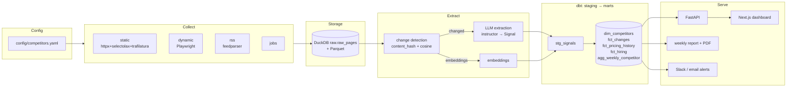

# Architecture

> **Xiaoshuyin Competitive Radar V1.** This document describes the V1 extension
> first. The upstream `compete` system design that is still retained follows
> below under **"upstream baseline (retained)"**. This is derived work; see
> [NOTICE](../NOTICE) and [README.md](../README.md#upstream-attribution).

## V1 flow (authoritative)

```
Collection → Snapshot → Diff → Pending Intelligence Queue → Antigravity → Intelligence Output → Frontend

  config/competitors.yaml   config/topics.yaml   context/xiaoshuyin.md
        (authority)            (authority)          (relevance guardrails)
              |                    |                       |
              v                    v                       |
  +---------------------------------------------------------------+
  | Collection   radar collect                                     |
  |   upstream collectors: httpx/static, Playwright/dynamic, RSS,  |
  |   jobs   (no second crawler)                                  |
  +-------------------------------+-------------------------------+
                                  | snapshots
                                  v
  +---------------------------------------------------------------+
  | Snapshot     raw.raw_pages (DuckDB) + data/raw/*.parquet        |
  | Diff         deterministic comparison between snapshots        |
  |              (upstream pipeline/detect/change.py)              |
  |              -> detected changes (NO AI involved)              |
  +-------------------------------+-------------------------------+
                                  | radar prepare (no AI)
                                  v
  +---------------------------------------------------------------+
  | Pending Intelligence Queue                                    |
  |   data/intelligence/pending/<change_id>.json                   |
  +-------------------------------+-------------------------------+
                                  | human-triggered hand-off
                                  | (deterministic file protocol)
                                  v
  +---------------------------------------------------------------+
  | Antigravity   EXTERNAL intelligence agent                      |
  |   reads pending + evidence + config/* + context + prior records|
  |   NOT a web-app runtime dependency; NO paid LLM API            |
  +-------------------------------+-------------------------------+
                                  | one record per change_id
                                  v
  +---------------------------------------------------------------+
  | Intelligence Output                                           |
  |   data/intelligence/records/<intelligence_id>.json  (ONE format)|
  |   data/intelligence/research/<request_id>.json  (low evidence)  |
  |   radar validate  (against data/intelligence/schema/*.schema.json)|
  +-------------------------------+-------------------------------+
                                  | radar build
                                  v
  +---------------------------------------------------------------+
  | Frontend   web/public/radar-static/radar.json                   |
  |   Next.js (Renderer, read-only) -> Vercel                      |
  |   four entries: Radar | Topics | Competitors | Evidence        |
  +---------------------------------------------------------------+
```

## Single Monitoring Authority

There is **exactly ONE monitoring authority** in V1: the upstream deterministic
pipeline. Everything that decides *what was collected* and *whether something
changed* lives there.

- One collection pipeline (upstream collectors), **no second crawler**.
- One raw-evidence store (upstream `raw.raw_pages` in DuckDB + `data/raw/*.parquet`),
  **no second database** and **no second raw-evidence database**.
- One diff engine / change-detection authority (upstream `pipeline/detect/change.py`),
  **no second diff engine** and **no second change-detection authority**.
- One competitor authority (`config/competitors.yaml`), **no second competitor
  registry** (the frontend is a renderer and must never hardcode a competitor list).

**AI cannot decide whether a change happened.** Change detection is a
deterministic comparison between collected snapshots. Antigravity (or any AI)
only *explains* a change that the pipeline has already detected and written to
the pending queue. AI prose is never written into the raw change authority.

## Authority table (V1)

| Concern | Single source of truth | Exact path |
|---|---|---|
| Competitors | `config/competitors.yaml` (55 onboarded objects: 34 Tier 1 / 21 Tier 2) | `config/competitors.yaml` |
| Topic taxonomy (13 topics) | `config/topics.yaml` | `config/topics.yaml` |
| Raw evidence | upstream `raw.raw_pages` (DuckDB) + `data/raw/*.parquet` | no second raw-evidence DB |
| Change detection | deterministic snapshot comparison | upstream `pipeline/detect/change.py` |
| Pending intelligence queue | `data/intelligence/pending/<change_id>.json` | per detected change |
| Intelligence | `data/intelligence/records/<intelligence_id>.json` | ONE format only |
| Manual research queue | `data/intelligence/research/<request_id>.json` | created on insufficient evidence |
| Weekly pulse | `data/intelligence/weekly/<week_start>.json` | file-based |
| JSON Schemas | `data/intelligence/schema/*.schema.json` | validation contract |
| Manual evidence | `evidence/manual/<evidence_id>/metadata.json` + assets | read-only input |
| Compiled frontend artifact | `web/public/radar-static/radar.json` | built by `radar build` |
| Xiaoshuyin context | `context/xiaoshuyin.md` | relevance guardrails |

See [AUTHORITY.md](./AUTHORITY.md) for the full model and the prohibited list.

## No paid LLM API

V1 uses **NO PAID LLM API**. No `OPENAI_API_KEY`, `GOOGLE_API_KEY`,
`GROQ_API_KEY`, Anthropic API, or any model key is required for the normal
workflow. `radar collect` / `radar prepare` never call a model, and GitHub
Actions runs only non-AI monitoring (collection, snapshot, diff, pending-queue
generation) and must never fail for a missing model key. Upstream
Gemini/Groq/Ollama/mock extraction code is retained for compatibility **only**
and is **not** the default path; `COMPETE_LLM_PROVIDER` defaults to `mock`.
Antigravity is an external, human-triggered intelligence agent — not a runtime
dependency and not a paid model API.

## Reuse / integration list

**Retained from upstream (verbatim foundation, reused first):**
- Python collection pipeline: httpx/static, Playwright/dynamic, RSS, jobs.
- Snapshots (content-addressed) and deterministic snapshot diff.
- Parquet raw layer (`data/raw/*.parquet`) and DuckDB warehouse (`raw.raw_pages`).
- dbt staging → marts, tests, docs.
- Static JSON export.
- Next.js + TypeScript + Tailwind + shadcn/ui frontend.
- Tests, CI patterns, static/serverless deployment.
- Upstream FastAPI kept for live mode / legacy compatibility only.

**Integrated in V1 (thin additions, no duplication):**
- Thin `radar` CLI wrapper over the upstream pipeline (`collect`, `prepare`,
  `validate`, `build`, `update`, `status`, `demo-build`).
- Deterministic file protocol for intelligence: pending queue, one intelligence
  record format, manual research queue, weekly pulse, JSON Schemas.
- Manual evidence folders under `evidence/manual/`.
- Compiled frontend artifact `web/public/radar-static/radar.json`.
- `.agents/` workspace skill (`competitor-intelligence`), rule, and workflow for
  the external Antigravity agent.
- Xiaoshuyin context at `context/xiaoshuyin.md` and topic taxonomy at
  `config/topics.yaml`.

**Deliberately NOT introduced:** a second crawler, a second diff engine, a second
database, a second competitor registry, a second change-detection authority, a
second intelligence store, localStorage CRUD as truth, or LLM-decided changes.

---

# Upstream baseline (retained)

> Everything below is the upstream `compete` architecture imported at baseline
> commit `ebc32b20c2016282976d2375af5821b530fa66bf` (2026-07-03). It is retained
> for the collection, detection, and warehouse layers V1 reuses. The
> `Extract (LLM)` / `LLM extraction` node described here is **compatibility-only
> in V1 and is NOT the default path** — V1 uses the no-key Antigravity file
> protocol instead (see "No paid LLM API" above and [AGENTS.md](./AGENTS.md)).

`compete` is a **deterministic pipeline with narrow LLM extraction nodes** - not
an autonomous free-roaming agent. Every stage is independently runnable,
debuggable, and cheap. The only "agentic" behaviour is structured extraction
with a validation-retry loop (see [AGENTS.md](./AGENTS.md)).

## System diagram (upstream baseline, retained)



## Data flow (upstream baseline, retained)

1. **Collect** - for each tracked URL in `competitors.yaml`, the matching
   collector fetches the public page (robots-respecting, throttled), extracts
   clean text, computes a `content_hash`, and writes a snapshot to
   `raw.raw_pages` (DuckDB) / Parquet.
2. **Detect (cheap, pre-LLM)** - compare the new `content_hash` to the previous
   snapshot. Unchanged → stop. Changed → compute embedding cosine similarity;
   high similarity (minor edit) → skip; low → it's a real change.
3. **Extract (LLM)** - only real changes are sent to the LLM, which returns a
   validated `Signal` (via `instructor`). Validation failure retries once with
   the error fed back. All calls logged with token counts for cost tracking.
   *(Compatibility-only in V1; the default V1 path is the Antigravity file
   protocol with `COMPETE_LLM_PROVIDER=mock`.)*
4. **Warehouse (dbt)** - `staging` cleans/normalizes; `marts` build the
   dimensional model and the `agg_weekly_competitor` rollup. `dbt test` enforces
   data quality.
5. **Serve** - FastAPI reads the marts; the Next.js dashboard renders them;
   the report node produces a weekly markdown brief (→ PDF); alerts fire on
   high-significance changes.

## Component responsibilities (upstream baseline, retained)

| Component | Responsibility | Why |
|-----------|----------------|-----|
| `pipeline/collect` | Fetch public pages politely; produce `RawPage` | Isolated, swappable per source type |
| `pipeline/storage` | Own the raw layer + DuckDB connection | Single writer; dbt only reads |
| `pipeline/detect` | Hash + embedding diff; gate the LLM | Minimizes LLM spend |
| `pipeline/extract` | `instructor`-enforced `Signal` + retry | Reliability over autonomy |
| `pipeline/llm` | Provider-agnostic client (Gemini/Groq/Ollama/mock) | Swap providers via env |
| `warehouse/dbt` | staging → marts, tests, docs | Declarative, testable transforms |
| `api` | Typed read API over marts + CRUD over config | Clean contract for the frontend |
| `web` | The dashboard (the product surface) | Where most quality effort goes |

## Key design decisions (upstream baseline, retained)

See [`adr/`](./adr/):
- **0001** - DuckDB over Postgres for the warehouse.
- **0002** - Snapshot-diffing (hash + embedding) over naive re-extraction.
- **0003** - Deterministic pipeline over an autonomous agent.

Rationale summary: cost control, reproducibility, and debuggability. The LLM is
used surgically (extract structure from already-known-changed content), never to
decide *what* to do. V1 keeps this guarantee and extends it: even the *explain*
step is an external, human-triggered Antigravity agent operating on a
deterministic file protocol, never an authority on whether a change happened.

V1 adds [ADR 0005](./adr/0005-antigravity-file-protocol.md) — Antigravity file
protocol, no paid LLM API.
